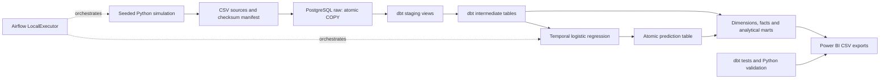

# Product Analytics & Data Modelling Platform

A complete local analytics engineering portfolio: synthetic SaaS activity becomes a PostgreSQL dimensional warehouse, tested product metrics, a temporal churn model, and CSV datasets for Power BI. The default simulation covers **1 January–30 September 2025**, with 10,000 users, five products and 15 features. All business and model results describe synthetic data.

[Explore the live analytics demo](https://prajuval69.github.io/Product_Analytics_Platform/) · [Public source repository](https://github.com/Prajuval69/Product_Analytics_Platform)

The live demo is a read-only snapshot of verified synthetic aggregates, hosted from `website/` with GitHub Pages. It does not run the warehouse, scheduler or training in your browser. After running the full local pipeline, rebuild its data with `.venv\Scripts\python.exe scripts\build_demo.py`; preview with `python -m http.server 8000 --directory website`. The published snapshot changes only when regenerated and committed. Verification counts below refer to the recorded October 2026 native run, not a current cloud pipeline run.



PostgreSQL 16+ is the primary and only analytics database. SQL transformations use real dbt-postgres; Airflow 2.10.5 provides the Docker orchestration path. Python 3.11/3.12, pandas, NumPy, scikit-learn, psycopg and pytest provide simulation, loading, ML and verification. The synchronous CLI executes the same tasks for environments without Docker. It is an execution entry point, not a scheduler.

## Run with Docker Compose

Prerequisites: Docker Engine/Desktop with Compose v2, approximately 4 GB of available RAM and 3 GB of disk space. From the repository root:

```powershell
Copy-Item .env.example .env
# Edit .env: set PG_PASSWORD, AIRFLOW_DB_PASSWORD and AIRFLOW_ADMIN_PASSWORD.
# Use unique local alphanumeric passwords, since the metadata URL is assembled by Compose.
docker compose build
docker compose up -d warehouse airflow-db
docker compose run --rm airflow-init
docker compose up -d airflow-webserver airflow-scheduler
docker compose exec airflow-scheduler airflow dags list-import-errors
docker compose exec airflow-scheduler python -m pytest /opt/platform/airflow/tests -q
docker compose exec airflow-scheduler airflow dags test product_analytics_pipeline 2025-09-30
docker compose run --rm --entrypoint /opt/analytics-venv/bin/python pipeline -m pytest -q
docker compose run --rm -e RUN_INTEGRATION=1 --entrypoint /opt/analytics-venv/bin/python pipeline -m pytest -q
docker compose exec airflow-scheduler airflow dags trigger product_analytics_pipeline
```

`dags test` executes the complete real DAG synchronously; `dags trigger` queues a normal run. Wait for successful completion before running integration tests or importing CSVs. Open [the local Airflow UI](http://localhost:8080) with username `admin` and your configured password. Do not run the CLI concurrently with a DAG run: both replace the same warehouse snapshot. To execute just the shared CLI inside Docker, use `docker compose run --rm pipeline`. To stop services without removing data, use `docker compose down`.

On Linux, create writable `data` and `outputs` directories and set `AIRFLOW_UID` in `.env` to your user ID (`id -u`) before Docker startup. The Compose user uses that UID and group 0, following the Airflow image's supported arbitrary-user mechanism.

## Run natively on Windows

Prerequisites: Python 3.12 and PostgreSQL 16+ binaries. The startup script creates an isolated project cluster, random ignored `.env` credentials, and database `analytics`, bound to `127.0.0.1:55432`. It does not modify an existing PostgreSQL service. Set `PG_BIN` if your binaries are elsewhere.

```powershell
python -m venv .venv
.venv\Scripts\python.exe -m pip install -r requirements.lock
.venv\Scripts\python.exe -m pip install --no-deps -e .
# Optional for a different PostgreSQL version/location:
# $env:PG_BIN = 'C:\Program Files\PostgreSQL\16\bin'
.\scripts\local_postgres.ps1 start
.venv\Scripts\python.exe -m platform_app.cli pipeline
$env:RUN_INTEGRATION = '1'
.venv\Scripts\python.exe -m pytest -q --junitxml=outputs/verification/pytest.xml
.venv\Scripts\ruff.exe check src scripts tests airflow
.\scripts\local_postgres.ps1 stop
```

On Linux/macOS, use a normal PostgreSQL installation with an empty `analytics` database and role, configure `.env`, and replace `.venv\Scripts\python.exe` with `.venv/bin/python`. The Windows startup script is specific to Windows. No paid API, real customer data, external account or Power BI installation is needed for the pipeline.

## Run components separately

The CLI loads `.env` and routes all commands through shared checked tasks:

```powershell
.venv\Scripts\python.exe -m platform_app.cli generate
.venv\Scripts\python.exe -m platform_app.cli load
.venv\Scripts\python.exe -m platform_app.cli quality
.venv\Scripts\python.exe -m platform_app.cli dbt-parse
.venv\Scripts\python.exe -m platform_app.cli dbt-build
.venv\Scripts\python.exe -m platform_app.cli features
.venv\Scripts\python.exe -m platform_app.cli ml
.venv\Scripts\python.exe -m platform_app.cli dbt-test
.venv\Scripts\python.exe -m platform_app.cli export
.venv\Scripts\python.exe -m platform_app.cli verify
.venv\Scripts\python.exe -m platform_app.cli dbt-docs
```

For direct dbt commands, export `.env` values into the process environment first. Then run `dbt parse --project-dir dbt --profiles-dir dbt`, `dbt build --project-dir dbt --profiles-dir dbt`, `dbt test --project-dir dbt --profiles-dir dbt` or `dbt docs generate --project-dir dbt --profiles-dir dbt`. dbt itself does not read dotenv. The CLI is the preferred credential-loading wrapper. Documentation is generated in `dbt/target/`.

## Data model and analytics

Seven raw tables feed seven staging models, seven intermediate tables, four dimensions, five facts and six marts: **29 dbt models**. Stable namespace-prefixed MD5 keys connect facts to dimensions. UTC calendar dates are used throughout; the user dimension is type 1 and plan is the immutable signup plan in this simulation.

| Fact | Grain |
|---|---|
| `fct_events` | One source event; feature key may be null |
| `fct_sessions` | One explicit user session, including non-active lifecycle sessions |
| `fct_transactions` | One invoice attempt; failed attempts contribute zero revenue |
| `fct_subscriptions` | One subscription lifetime per paid user in this simulation |
| `fct_support_tickets` | One support ticket, possibly unresolved |

Product marts calculate daily DAU, rolling WAU/MAU, seven-day activation, an ordered 30-day funnel, exact-day D1/D7/D30/D60/D90 retention, monthly feature adoption, 30-day inactivity/cancellation churn, daily revenue/ARPU/ARPPU, MRR and customer segments. Rates retain their numerator and denominator. Do not sum distinct-user metrics over dates or average segment rates without denominator weighting. See [canonical metric definitions](docs/METRICS.md).

The ML pipeline uses three disjoint observation/outcome snapshots for train, validation and test. It trains class-balanced Logistic Regression, chooses a threshold on validation, reports test ROC-AUC/precision/recall/F1/confusion matrix, persists the evaluated model, and scores eligible customers at the final source date. Identifiers, future outcomes and current customer-health statuses are excluded from predictors. See [ML methodology](docs/ML_METHODOLOGY.md).

## Outputs and dashboard

`outputs/bi/` contains 13 CSV extracts: executive KPIs, product funnel, retention cohorts, feature adoption, customer health, churn predictions, revenue/subscription analytics, data quality and supporting dimensions/subscriptions. `outputs/ml/` contains features, model, metadata, evaluation, coefficients and predictions. `outputs/verification/` contains pipeline audits, dbt test evidence and validation row counts.

Power BI is a manual consumption layer. Seven dashboard pages cover Executive Overview, Product Funnel, Retention, Feature Adoption, Customer Health, Revenue & Subscriptions and Data Quality. [The build guide](docs/POWER_BI_BUILD_GUIDE.md) specifies relationships, measures, slicer coverage and visual layouts. No `.pbix` or dashboard screenshot is fabricated.

## Verification, limitations and interview explanation

Run unit tests with `.venv\Scripts\python.exe -m pytest -m "not integration and not airflow" -q`. Run all tests with `RUN_INTEGRATION=1` after a completed pipeline. The real Airflow DagBag test is skipped on Windows and must run inside the supplied Linux image. [FINAL_VERIFICATION.md](FINAL_VERIFICATION.md) records actual executed results and limitations; Docker/Airflow execution must not be inferred from native CLI success.

Default data is approximately one million events, rebuilt as a complete snapshot. There is no incremental watermark, SCD2, refund processing, multi-currency conversion, multiple concurrent products per customer or real SaaS payment integration. Subscription billing uses 30-day intervals; MRR is contracted monthly list price, not cash revenue. Synthetic model performance cannot establish real-world predictive value. A single local warehouse role and full-refresh loading are portfolio tradeoffs; production needs restricted roles, secrets management, CDC, concurrency controls, deployment CI and drift monitoring. `.env`, data, warehouse files, model artifacts and caches are ignored; verification summaries and source specifications are reviewable.

Interview summary: “I built a repeatable product analytics warehouse from synthetic events. PostgreSQL stores raw snapshots, dbt models a tested star schema and product marts, Airflow controls dependencies and retries, and a temporal churn model adds customer risk scores. The difficult parts were consistent metric denominators, preventing future leakage, and proving that the source data, SQL, model and reporting exports reconcile.” More questions and tradeoffs appear in [the interview guide](docs/INTERVIEW_GUIDE.md).

Additional documentation: [architecture](docs/ARCHITECTURE.md), [setup](docs/SETUP.md), [data dictionary](docs/DATA_DICTIONARY.md), [dbt models](docs/DBT_MODELS.md), [Airflow](docs/AIRFLOW.md), [testing](docs/TESTING.md), [troubleshooting](docs/TROUBLESHOOTING.md).
